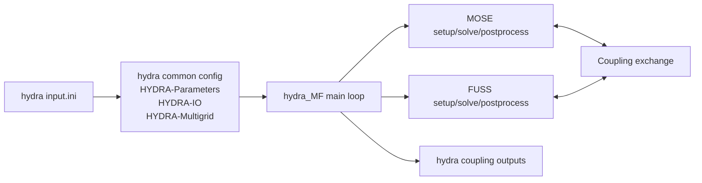

# Code Structure

This page documents the Hydra repository layout and the framework-level
architecture used to compose multiple solver libraries into a single
executable.

## Repository Layout

```text
hydra/
├── CMakeLists.txt                # Top-level CMake configuration
├── bootstrap.sh                  # Shell/bootstrap setup
├── scripts/                      # figaro CLI and task modules
│   ├── figaro.sh
│   └── modules/
│       ├── building/
│       ├── compile/
│       ├── simulations/
│       └── git.sh
├── src/
│   ├── app/                      # Framework executables
│   │   ├── common/
│   │   │   ├── base/             # Framework globals/utilities
│   │   │   └── config/           # HYDRA-* input registry and parsing
│   │   └── MF/                   # Coupled MOSE+FUSS executable logic
│   └── lib/                      # Solver libraries as submodules
│       ├── MOSE/
│       ├── FUSS/
│       └── GROOT/
├── lib/                          # Shared dependencies (ORION, FLINT, OSLO, FiNeR)
├── test/                         # Framework-level validation assets
│   ├── hydra-MF.sh
│   └── Tw-Flat-Plate/
└── docs/                         # Framework documentation
```

## Framework vs Solver Responsibilities

| Layer | Responsibility |
|-------|----------------|
| Hydra framework (`src/app`) | Runtime orchestration, coupling schedule, shared input handling, coupled I/O |
| solver libraries (`src/lib/*`) | Physics models, numerics, and solver-local input/output |
| shared dependencies (`lib/*`) | Common services (INI parsing, I/O backends, thermochemistry, ODE) |

A practical rule: put solver-specific math/physics in solver repos, and put cross-solver coordination in Hydra.

## Executable Model

The current framework executable is selected by `EXE_NAME` in CMake.
At the moment, `MF` is the supported target, producing `hydra_MF`.



## Runtime Pipeline (`hydra_MF`)

At a high level, `src/app/MF/hydra_MF.f90` does the following:

1. Initialize parallel runtime (MPI/OpenMP through solver modules).
2. Read framework configuration (`HYDRA-*` sections).
3. Initialize solver objects and call both solver setup phases.
4. Build cross-solver coupling schedule for each active level.
5. Run the coupling loop:
   - choose per-solver iteration counts
   - optional synchronized time-accurate step control
   - alternate/sequence solver solves
   - exchange coupled boundary data
   - trigger intermediate/final postprocess
6. Finalize schedules and MPI state.

## Configuration Subsystem

Framework input registration lives in `src/app/common/config`.
Registered sections are:

- `HYDRA-Parameters`
- `HYDRA-IO`
- `HYDRA-Multigrid`

These sections coexist with solver sections in the same `input.ini`
file. Hydra consumes only `HYDRA-*` keys; solver libraries consume
their own sections.

## Build and Task Orchestration

The user-facing entrypoint is `figaro` (defined by bootstrap shell
integration), implemented in `scripts/figaro.sh`.

Major task groups:

| Command family | Module |
|----------------|--------|
| `figaro build ...` | `scripts/modules/building/` |
| `figaro compile ...` | `scripts/modules/compile/` |
| `figaro <solver> ... solve` | `scripts/modules/simulations/solve.sh` |
| `figaro submodule ...` | `scripts/modules/git.sh` |
| `figaro doctor` | `scripts/doctor.sh` |

## Dependency Wiring

For `EXE_NAME=MF`, top-level CMake brings in:

- shared deps: ORION, FiNeR, FLINT
- solver libs: FUSS and MOSE
- framework executable sources from `src/app/common/*` and `src/app/MF`

This keeps Hydra focused on composition while solver internals remain
in their dedicated repositories.
