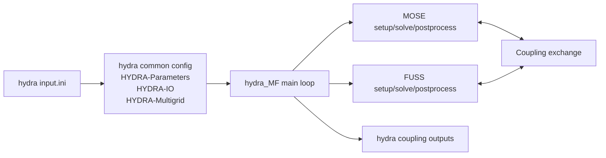

# Code Structure

This page documents the Hydra repository layout and the framework-level
architecture used to compose multiple solver libraries into a single
executable.

## Repository Layout

```text
hydra/
├── CMakeLists.txt                # Top-level CMake configuration
├── bootstrap.sh                  # Shell/bootstrap setup
├── scripts/                      # figaro CLI and task modules
│   ├── figaro.sh
│   └── modules/
│       ├── building/
│       ├── compile/
│       ├── simulations/
│       └── git.sh
├── src/
│   ├── app/                      # Framework executables
│   │   ├── common/
│   │   │   ├── base/             # Framework globals/utilities
│   │   │   └── config/           # HYDRA-* input registry and parsing
│   │   ├── MF/                   # Coupled MOSE+FUSS executable logic
│   │   ├── AF/                   # Coupled ARES+FUSS executable logic
│   │   └── MI2/                  # Coupled MOSE+ICE+IGLOO executable logic
│   └── lib/                      # Solver libraries as submodules
│       ├── MOSE/
│       ├── FUSS/
│       ├── GROOT/
│       ├── ARES/
│       ├── ICE/
│       └── IGLOO/
├── lib/                          # Shared dependencies (ORION, FLINT, OSLO, FiNeR)
├── test/                         # Framework-level validation assets
│   ├── hydra-MF.sh
│   ├── MF-flatplate-Tw/          # hydra-MF conjugate flat plate
│   └── AF-flatplate-Tw/          # hydra-AF conjugate flat plate
├── docs/                         # Framework documentation (Zensical, mkdocs.yml)
├── mkdocs.yml                    # Documentation site configuration
└── requirements-docs.txt         # Zensical version the site is built with
```

## Framework vs Solver Responsibilities

| Layer | Responsibility |
|-------|----------------|
| Hydra framework (`src/app`) | Runtime orchestration, coupling schedule, shared input handling, coupled I/O |
| solver libraries (`src/lib/*`) | Physics models, numerics, and solver-local input/output |
| shared dependencies (`lib/*`) | Common services (INI parsing, I/O backends, thermochemistry, ODE) |

A practical rule: put solver-specific math/physics in solver repos, and put cross-solver coordination in Hydra.

## Executable Model

The framework executable is selected by `EXE_NAME` in CMake: `MF`, `AF` or
`MI2`, producing `bin/hydra_MF`, `bin/hydra_AF` or `bin/hydra_MI2`.



## Runtime Pipeline (`hydra_MF`)

At a high level, `src/app/MF/hydra_MF.f90` does the following:

1. Initialize parallel runtime (MPI/OpenMP through solver modules).
2. Read framework configuration (`HYDRA-*` sections).
3. Initialize solver objects and call both solver setup phases.
4. Build cross-solver coupling schedule for each active level.
5. Run the coupling loop:
   - choose per-solver iteration counts
   - optional synchronized time-accurate step control
   - alternate/sequence solver solves
   - exchange coupled boundary data
   - trigger intermediate/final postprocess
6. Finalize schedules and MPI state.

## Runtime Pipeline (`hydra_MI2`)

`src/app/MI2/hydra_MI2.f90` couples a gas with dispersed condensed phases
(see [Multiphase Coupling](../user/mi2.md)):

1. Print the build stamp (`MI2_Build_Stamp.cmake` writes it at every build).
2. Read the `HYDRA-*` sections and MI2's own keys (`MI2_Read_Ini.f90`,
   `MI2_Register_Params.f90`) and print the coupling schedule.
3. Route each `INPUT/*phase.txt` to MOSE, ICE or IGLOO and check the files
   each will open (`MI2_Mod_Import.f90`).
4. Set up MOSE, then ICE and IGLOO when enabled; read each condensed phase's
   `products.txt` into gas-species rows and enthalpy-datum offsets
   (`MI2_Stoichiometry.f90`); set up the smoke families.
5. Run the cycles: per coupling step a MOSE block (the condensed sources
   applied at every Runge-Kutta stage through MOSE's external routine), an
   IGLOO solve, an ICE block.
6. Final postprocess of each solver and the end-of-run balances.

`hydra_MI2.f90` holds only that schedule. The rest of `src/app/MI2/`:

| File | Holds |
|---|---|
| `MI2_Read_Ini.f90` | the input, and what MI2 refuses in the solvers' own sections once their setup has read them |
| `MI2_Coupling.f90` | the exchange: each solver's coupling setup, the gas state to IGLOO and ICE, their sources into MOSE's residual (one cell kernel per source, shared with the books), and what lands between solver steps: ICE's stored removals, its mean source over a time-accurate block, IGLOO's smoke born in ICE |
| `MI2_Restart.f90` | the restart rules and ICE's hand-off file |
| `MI2_Report.f90` | the setup notices, the `[MI2-report]` lines, the run's mass and energy books and the end-of-run balances |

`hydra_MI2` is OpenMP only: the top-level `CMakeLists.txt` stops the configure
step when `USE_MPI` is set with `EXE_NAME=MI2`.

## Configuration Subsystem

Framework input registration lives in `src/app/common/config`.
Registered sections are:

- `HYDRA-Parameters`
- `HYDRA-IO`
- `HYDRA-Multigrid`

These sections coexist with solver sections in the same `input.ini`
file. Hydra consumes only `HYDRA-*` keys; solver libraries consume
their own sections. `hydra_MI2` adds its keys to `HYDRA-Parameters`
(`src/app/MI2/MI2_Register_Params.f90`) and reads `[MI2-Coupling]`.

## Build and Task Orchestration

The user-facing entrypoint is `figaro` (defined by bootstrap shell
integration), implemented in `scripts/figaro.sh`.

Major task groups:

| Command family | Module |
|----------------|--------|
| `figaro build ...` | `scripts/modules/building/` |
| `figaro compile ...` | `scripts/modules/compile/` |
| `figaro <solver> ... solve` | `scripts/modules/simulations/solve.sh` |
| `figaro submodule ...` | `scripts/modules/git.sh` |
| `figaro doctor` | `scripts/doctor.sh` |

## Dependency Wiring

For `EXE_NAME=MF`, top-level CMake brings in:

- shared deps: ORION, FiNeR, FLINT
- solver libs: FUSS and MOSE
- framework executable sources from `src/app/common/*` and `src/app/MF`

For `EXE_NAME=MI2`:

- shared deps: ORION (linked explicitly, since ICE links it privately), FiNeR
- solver libs: MOSE, ICE and IGLOO
- framework executable sources from `src/app/common/*` (without the shared timers) and `src/app/MI2`

This keeps Hydra focused on composition while solver internals remain
in their dedicated repositories.
